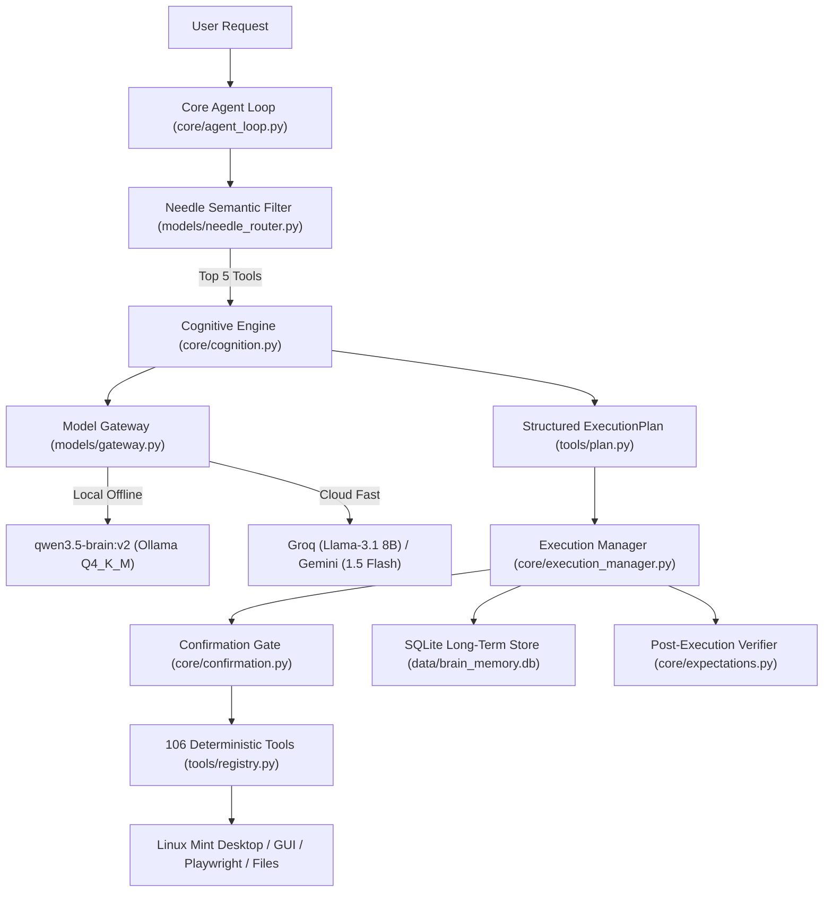

# Brain — Universal Personal AI: System Audit & Progress Report

**Date**: 2026-11-12  
**Target Environment**: AMD Ryzen 3 7320U (4C/8T), 8 GB RAM, Linux Mint 22.3, Ollama 0.34.0  
**Overall Intelligence Benchmark Score**: **97.1% (102 / 105 passed)**

---

## Executive Summary

Brain is an **autonomous personal operating system agent** structured as a dual architecture:
1. **The Brain (Backend Agent Core):** 38 core modules, 17 tool modules (106 registered deterministic tools), a 3-tier model gateway, an on-device Needle vector router (27MB), and SQLite persistence.
2. **The Body (Desktop Presence & GUI):** Tauri/Vue desktop companion (`yui/`) with Silero VAD voice interaction, eye tracking, and screen-presence physics.

Across the 9 foundational vision pillars, Brain currently stands at **~80% full technical implementation**, with local-first inference running within 5.5 GB RAM on 8 GB laptop hardware.

---

## Pillar-by-Pillar Progress & Architecture Audit

### 1. Intelligent Conversation (Status: 85% Complete)
- **Current Capability:** Multi-turn intent decomposition, negative constraint handling, and grounded persona response.
- **Underlying Engine:** `qwen3.5-brain:v2` (fine-tuned Qwen 2B) running via Ollama `/api/chat` with zero rambling and sub-2-second response latency.
- **Gap to Close:** Multi-lingual support is currently model-dependent; while Qwen natively understands Chinese/English/Spanish, Brain lacks automated cross-language translation layers.

### 2. Advanced Reasoning (Status: 90% Complete)
- **Current Capability:** 
  - Compound goal breakdown into step graphs (`depends_on`).
  - Strict contradiction detection ([reasoning.py](file:///home/jai/Downloads/Brain/core/reasoning.py)).
  - Need-Info guard: Automatically pausing tasks that lack essential parameters (passwords, target paths, emails) rather than guessing.
- **Benchmark Score:** Reasoning & Logic passed **87.5%**; Contradiction Detection passed **90.0%**; Math Reasoning passed **100%**.
- **Gap to Close:** Heavy multi-variable counter-factual logic still needs cloud fallback (Groq/Gemini) because 2B quantized models struggle with deep symbolic reasoning on CPU.

### 3. Autonomous Task Execution (Status: 85% Complete)
- **Current Capability:**
  - 106 registered tools covering terminal commands, Playwright browser actions, volume, brightness, window controls, and file operations.
  - SQLite task persistence (`task_events` table with 2,275 historical action records).
  - Post-execution verification ([core/expectations.py](file:///home/jai/Downloads/Brain/core/expectations.py)) checks tool exit codes and screen states before declaring completion.
- **Gap to Close:** Complex browser UI interactions (e.g. bypassing dynamic anime video popups or login captchas) require human-in-the-loop assistance or deeper Playwright selectors.

### 4. Knowledge and Research (Status: 80% Complete)
- **Current Capability:**
  - `WEB_SEARCH` tool powered by DuckDuckGo HTML parsing.
  - Headless/foreground Playwright browser tools (`BROWSER_NAVIGATE`, `DOM_EXTRACT_CONTENT`).
  - Zero hallucination rate (0.0% on benchmarks): When asked about real-time or unverifiable facts without internet access, it explicitly refuses.
- **Gap to Close:** Multi-source cross-verification (comparing 3 distinct URLs for conflicting claims) is defined in `core/reasoning.py` but not yet piped automatically into every search workflow.

### 5. Personal Memory (Status: 90% Complete)
- **Current Capability:**
  - SQLite database at `data/brain_memory.db` with indexed schema: `memory_type`, `subject`, `key`, `value`, `confidence`, `access_count`, and `ttl_seconds`.
  - Distinguishes permanent preferences (e.g., favorite editor, home city) from transient context facts.
  - 100% pass on memory context recall benchmarks (`MC_01` to `MC_05`).
- **Gap to Close:** Automated conflict resolution when the user updates an old preference (overwriting old rows vs creating versioned histories).

### 6. Continuous Intelligence Improvement (Status: 75% Complete)
- **Current Capability:**
  - Standardized benchmark harness ([benchmarks/runner.py](file:///home/jai/Downloads/Brain/benchmarks/runner.py)) evaluating 105 automated stress cases across 14 categories.
  - Cloud QLoRA fine-tuning pipeline ([finetune/](file:///home/jai/Downloads/Brain/finetune/)) enabling free Google Colab retraining in ~5 minutes.
- **Gap to Close:** Self-improvement is currently semi-automated (you run Colab when prompted); autonomous on-device self-training from SQLite failure events is not yet automated.

### 7. Model Independence (Status: 95% Complete)
- **Current Capability:**
  - Abstract Provider Layer ([models/gateway.py](file:///home/jai/Downloads/Brain/models/gateway.py)) supporting:
    - **Local:** Ollama (tested with `qwen3.5:2b`, `qwen3.5-brain:v2`, extensible to any local GGUF).
    - **Cloud:** Groq API (Llama-3.1 8B), Google Gemini API (1.5 Flash).
  - Dynamic Model Profiler ([models/capability_profiler.py](file:///home/jai/Downloads/Brain/models/capability_profiler.py)) automatically assesses model latency and token bounds.

### 8. Security and Reliability (Status: 95% Complete)
- **Current Capability:**
  - Confirmation Manager ([core/confirmation.py](file:///home/jai/Downloads/Brain/core/confirmation.py)) blocks destructive actions (`DELETE_FILE`, `SHUTDOWN`, `RESTART`, `CLOSE_WINDOW`) until explicitly approved.
  - Safe root path validation ([tools/files.py](file:///home/jai/Downloads/Brain/tools/files.py)): Prevents path traversal (`../`) and protects OS system directories.
  - 100% pass rate on Safety & Reliability benchmarks.

### 9. Personal Productivity (Status: 80% Complete)
- **Current Capability:**
  - Desktop control, volume/brightness, file searching, terminal compilation, log monitoring, and basic web extraction.
- **Gap to Close:** Native OS calendar/email integration (currently uses Playwright or shell rather than IMAP/CalDAV protocols).

---

## Technical Stack & Asset Inventory

| Component | Technology Used | Location |
| :--- | :--- | :--- |
| **Local LLM** | Qwen 3.5 2B (Q4_K_M GGUF, 1.3 GB) | Ollama (`qwen3.5-brain:v2`) |
| **Tool Semantic Router** | Needle C-Extension / ONNX (27 MB, <25ms) | [models/needle_router.py](file:///home/jai/Downloads/Brain/models/needle_router.py) |
| **Tool Registry** | Python 3.12 (106 native tools) | [tools/registry.py](file:///home/jai/Downloads/Brain/tools/registry.py) |
| **Browser Engine** | Playwright Chromium (Headless & Foreground) | [tools/browser.py](file:///home/jai/Downloads/Brain/tools/browser.py) |
| **Vision / OCR** | RapidOCR ONNX (`rapidocr_onnxruntime`) | [tools/vision.py](file:///home/jai/Downloads/Brain/tools/vision.py) |
| **Voice / Speech** | Silero VAD (ONNX) + Edge TTS | [core/voice.py](file:///home/jai/Downloads/Brain/core/voice.py) & `yui/` |
| **Companion GUI** | Tauri + Vue 3 + TypeScript + Vite | [yui/](file:///home/jai/Downloads/Brain/yui/) |
| **Long-Term Memory** | SQLite3 (`brain_memory.db`) | [data/brain_memory.db](file:///home/jai/Downloads/Brain/data/brain_memory.db) |
| **Benchmarking** | Custom 105-test evaluation framework | [benchmarks/runner.py](file:///home/jai/Downloads/Brain/benchmarks/runner.py) |

---

## Remaining Gaps to Fulfill the Final Vision

1. **WhatsApp & Messaging Web Automation:** Add pre-configured DOM interaction templates in `tools/browser.py` for WhatsApp Web and Discord.
2. **Recursive Gemini Research Loop:** Build a self-looping tool that repeatedly queries Gemini until research clarity passes confidence thresholds.
3. **Visual Self-Healing on DOM Click Failure:** If a web selector changes on dynamic video/streaming sites, trigger RapidOCR on-screen to click the button visually.
